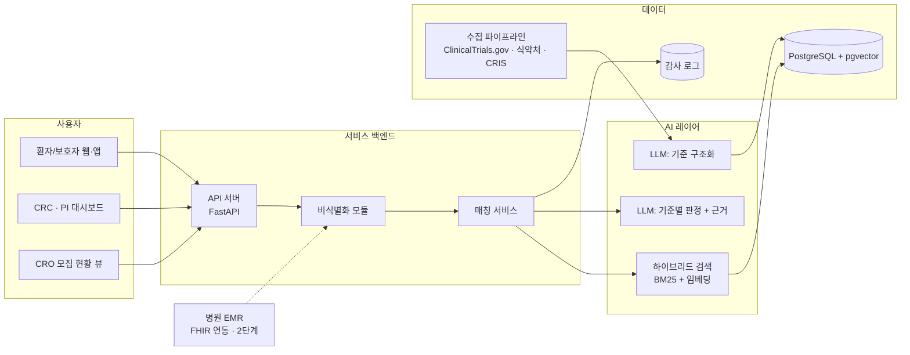

# 4차 미션(7개 도메인 아이디어톤) — AI Healthcare(바이오) 주제 제안서

> 작성 기준일: 2026-11-21(토) · 제출 마감: 2026-11-26(목) 13:00 · 팀 4인 · 결과물: 기획서(Markdown/Word) + 발표자료(PPT/PDF)
> 이 문서는 "주제 확정 → 기획서 작성 → 발표"까지 바로 쓸 수 있도록 ① 후보 비교, ② 추천 주제 기획서 초안(미션 8개 항목 전부), ③ 발표 구성, ④ 5일 일정·역할, ⑤ 전문가 예상 질문 순으로 구성했습니다.

---

## 0. 미션 요구사항 요약 (문서에서 추출)

| 항목 | 요구사항 |
|---|---|
| 도메인 | 7대 도메인 중 택1 → 바이오는 **AI Healthcare** |
| 필수 포함 항목 | 문제 정의 / 타겟 사용자 / 서비스 개요 / AI 기술 적용 / 시스템 구성(다이어그램 권장) / 기대 효과 / 향후 발전 방향 / 팀 역할 분담 |
| 제약 | 도메인 관련 AI 기술이 서비스의 **핵심**이어야 함, 전원 참여, 발표자료에 역할 분담 명시 |
| 평가 포인트(과제 목표에서 역산) | 산업 현황·이슈 파악, 문제 정의와 배경, 타겟 니즈 구체성, AI 기술 선택 이유, 기대효과·로드맵, 협업 과정 |
| 예시 기획서 | "AI 당뇨 관리 앱" → **흔한 B2C 건강앱은 예시와 겹쳐 차별성 점수에서 불리** |

전문가 평가에서 점수가 갈리는 지점은 "문제가 진짜인가(수치 근거)", "왜 AI여야 하는가", "기존 서비스와 뭐가 다른가", "현실적으로 되는가(데이터·규제)"입니다. 아래 후보는 모두 이 네 가지에 답할 수 있게 골랐습니다.

---

## 1. 후보 주제 3개 비교

### 후보 A (추천) — AI 임상시험 적격성 매칭 플랫폼 「TrialFit」
- **한 줄 요약**: 임상시험 프로토콜의 선정/제외 기준을 LLM이 구조화하고, 환자 정보와 기준 단위로 대조해 "적합 / 부적합 / 정보 부족 + 근거"를 설명하는 매칭 서비스. 연구코디네이터(CRC)의 스크리닝 시간과 환자의 탐색 시간을 동시에 줄인다.
- **왜 바이오인가**: 제약·바이오 R&D에서 가장 비싸고 느린 단계가 임상이고, 임상에서 가장 흔한 지연 원인이 **대상자 모집**이다.
- **핵심 수치**
  - 식약처 2025년 임상시험 승인 783건(전년 대비 +4.8%), 제약사 주도 668건, 바이오의약품 임상 313건(+23.7%)
  - 서울은 제약사 주도 임상시험 도시 순위 2023년 1위 → 2024년 2위(베이징에 역전). 한국은 초기단계 임상 편중, 2·3상은 10위권 밖(ABPI 2026 보고서 인용 보도)
  - Tufts CSDD 조사: 계획한 기간 안에 모집을 끝낸 연구는 47%, 53%는 기간 연장
  - NIH TrialGPT(Nature Communications, 2024.11): 기준 단위 판정 정확도 87.3%(전문가 수준), 임상의 스크리닝 시간 42.6% 단축, 검색 단계에서 전체 시험의 6% 미만만 보고도 관련 시험 90% 이상 회수
- **기존 서비스와의 차이**: 한국임상시험참여포털(KoNECT, 2026 운영 시작)은 관심 질환·지역을 적은 "참여의향서"를 연구자에게 연계하는 **키워드·의향서 기반**이고 적격성 판정은 없다. 서울성모병원이 EMR 기반 적격자 검토 AI를 자체 개발·특허(2026.09)했지만 **단일 기관 내부용**이다. TrialFit은 공개 등록 정보 기반 **다기관 + 기준 단위 설명형 매칭**이라는 빈 자리를 노린다.
- **강점**: AI가 서비스의 핵심(LLM + 검색 + 설명가능성), 선행 연구로 실현 가능성 입증, B2B 수익모델 명확, 예시 기획서(당뇨앱)와 완전히 다른 결
- **약점/리스크**: 의료정보 규제(개인정보보호법·의료법), 환각 리스크 → 사람이 최종 확인하는 구조로 설계해 방어

### 후보 B — 노인 다제약물 AI 선별·관리 서비스 「약챙김」
- **한 줄 요약**: 처방 이력을 분석해 약물 상호작용·노인부적절약물·중복처방 위험을 점수화하고, 약사 상담이 필요한 고위험군을 **먼저 찾아주는** 우선순위(트리아지) 엔진 + 보호자용 쉬운 복약 설명.
- **핵심 수치**
  - 2025년 10종 이상 약 복용자 143.9만 명(5년 새 +54.3%), 이 중 고령자 82.1%
  - 건보공단 다제약물관리사업으로 상담받은 사람은 1.16만 명 → **대상자의 0.8%**
  - 65세 이상 중 90일 이상 5개 이상 복용 264만 명(36%, 심평원 2024 청구자료), 75세 이상 다제병용률 64.2%로 OECD 평균 50.1% 상회
  - 사업 참여자는 비참여군 대비 응급실 이용 23%(65세 이상 27%) 감소
- **차별점**: 기존 사업은 약사 방문 인력에 의존해 커버리지가 0.8%에 그침 → AI로 "누구를 먼저 볼지"를 정해 같은 인력으로 커버리지를 늘린다.
- **강점**: 수치가 매우 강하고 공공데이터(심평원·DUR) 접근성이 좋음, 사회적 효과 명확
- **약점**: 상호작용 체크는 이미 DUR이 규칙 기반으로 하고 있어 "왜 AI인가"를 설득하려면 **부작용 입원 위험 예측 모델 + LLM 설명**을 핵심으로 세워야 함. 의약품안전사용서비스와의 관계 설명이 필요.

### 후보 C — 희귀질환 진단 방랑 단축 AI 「DxCompass」
- **한 줄 요약**: 환자가 자연어로 적은 증상 이력을 표준 표현형 용어(HPO)로 변환하고, 희귀질환 후보와 진료 가능한 전문기관을 제시해 "어느 병원에 가야 하는지"를 안내.
- **핵심 수치**: 질병관리청 위탁 2025년 희귀질환 실태조사(1,031명) 기준 확진까지 평균 3.5년, 월소득 700만 원 이상 2.21년 vs 100만 원 미만 7.89년. 환자단체 조사 기준 평균 2.9년, 병원 2.7곳 방문.
- **강점**: 사회적 임팩트와 스토리가 가장 강함, 공개 지식베이스(Orphanet, HPO) 존재
- **약점**: "진단 보조"는 의료기기 소프트웨어(SaMD) 규제 영역이라 검증·책임 질문이 가장 거셈. 한국어 희귀질환 학습 데이터가 거의 없어 실현 가능성 점수에서 불리.

### 비교표 (5점 만점, 팀 토론용)

| 기준 | A 임상시험 매칭 | B 다제약물 | C 희귀질환 |
|---|:-:|:-:|:-:|
| 문제의 크기·수치 근거 | 4 | 5 | 4 |
| AI가 핵심인가(왜 AI여야 하나) | 5 | 3 | 4 |
| 기존 서비스 대비 차별성 | 5 | 4 | 4 |
| 실현 가능성(데이터·규제·5일 기획) | 4 | 5 | 2 |
| 바이오 산업 연관성 | 5 | 3 | 4 |
| 예시 기획서와 겹치지 않음 | 5 | 3 | 5 |
| **합계** | **28** | **23** | **23** |

**추천: 후보 A.** 팀이 "소비자 접점이 많은 쪽"을 원하면 B, "임팩트 스토리"를 원하면 C로 가되, 아래 기획서 초안의 뼈대는 그대로 재사용할 수 있습니다.

---

## 2. 추천 주제 기획서 초안 — 「TrialFit: AI 임상시험 적격성 매칭 플랫폼」

(미션이 요구하는 8개 항목 순서 그대로. 괄호 안 `[팀 작성]`은 팀원이 채울 부분)

### 2.1 문제 정의

**배경**
- 국내 임상시험은 2025년 783건 승인으로 다시 증가세이며, 특히 바이오의약품 임상이 313건으로 23.7% 늘었다. 과제 수가 늘수록 같은 질환군 환자를 두고 시험 간 모집 경쟁이 심해진다.
- 임상시험의 대표적인 지연 원인은 대상자 모집이다. Tufts CSDD 조사에서 계획 기간 내 모집을 마친 연구는 47%에 불과했다.
- 현장 방식은 연구코디네이터가 EMR을 수작업으로 뒤져 예비 적격자를 찾고 전화로 의사를 묻는 구조다(메디컬타임즈 2025.02 보도). 프로토콜 1건의 선정/제외 기준은 보통 20~40개 항목이고 자유 텍스트라 사람이 매번 다시 읽어야 한다.
- 환자 쪽에서는 "내 상태로 참여할 수 있는 임상시험이 있는지"를 알 방법이 사실상 없다. 공공 포털은 질환명 키워드 검색과 의향서 접수까지만 지원한다.
- 산업 관점: 서울은 2024년 임상시험 도시 순위 1위를 베이징에 내줬고, 한국은 2·3상 유치에서 10위권 밖이다. 모집 속도는 다국가 임상 유치의 핵심 경쟁력이다.

**해결하고자 하는 문제**
1. 연구자(CRC/PI)가 프로토콜 기준을 읽고 환자를 대조하는 **반복적 스크리닝 노동**
2. 환자가 자신에게 맞는 임상시험을 **찾지 못하는 정보 비대칭**
3. 둘 사이를 잇는 과정에서 **왜 적합/부적합인지 근거가 남지 않는 문제**(재검토·감사 불가)

**주제 선택 이유**
- AI Healthcare 도메인 중 소비자 건강앱이 아니라 **제약·바이오 R&D 파이프라인의 병목**을 겨냥해 차별화
- 자유 텍스트 이해(LLM), 대규모 후보 검색(Retrieval), 설명 가능한 판정(criterion-level reasoning)이라는 AI 핵심 기술이 서비스의 중심
- NIH TrialGPT가 2024년 동일 접근법의 성능을 입증했고, 국내에는 다기관 서비스가 없어 "지금, 한국에서" 해야 할 이유가 분명

### 2.2 타겟 사용자

| 구분 | 사용자 | 핵심 니즈 | 현재 불편 |
|---|---|---|---|
| 1차(핵심 고객) | 상급종합병원 임상시험센터의 **연구코디네이터(CRC)·연구간호사**, 연구책임자(PI) | 담당 과제별 예비 적격자를 빨리, 근거와 함께 찾기 | 과제 10개 이상 동시 담당, 하루 2~3시간 EMR 수작업 스크리닝, 기준 해석이 사람마다 다름 |
| 2차(지불 고객) | 제약사·CRO의 **모집 담당자/CTM** | 기관별 모집 속도 예측, 지연 과제 조기 식별 | 기관 보고에 의존, 모집 지연을 늦게 인지 |
| 3차(수혜자) | 표준치료 실패 후 대안을 찾는 **암·희귀질환 환자와 보호자** | "내가 참여할 수 있는 시험이 있나, 어디로 가야 하나"를 쉬운 말로 | 키워드 검색만 가능, 기준 문서를 이해 못 함 |

**페르소나 예시** `[팀 작성: 인터뷰 또는 기사 인용으로 보강]`
- CRC 김OO(34): 서울 상급종합병원 종양내과, 항암제 2상 과제 8개 담당. 매주 신규 환자 차트를 열어 기준을 대조. "어제 봤던 환자가 다른 과제엔 맞는지" 다시 보는 일이 잦다.
- 환자 박OO(58): 비소세포폐암 3기, 2차 치료 반응 없음. 인터넷에서 "폐암 임상시험"을 검색했지만 영어 기준 문서를 이해하지 못해 포기.

### 2.3 서비스 개요

**서비스명**: TrialFit (가칭) — "환자와 임상시험의 핏을 기준 하나하나로 설명하는 매칭"

**핵심 기능**
1. **기준 구조화 엔진**: 프로토콜/등록정보의 선정·제외 기준 텍스트를 LLM이 `{항목, 유형(연령·진단·바이오마커·검사수치·이전치료·동반질환), 조건, 원문}` JSON으로 구조화
2. **양방향 매칭**:
   - 환자 → 시험: 환자 요약(자가입력 또는 비식별 EMR 요약)을 받아 후보 시험을 검색하고 기준별로 `적합 / 부적합 / 정보 부족`을 판정, 근거 문장을 함께 표시
   - 시험 → 환자: CRC가 과제를 선택하면 등록된 예비 환자 풀에서 적격 가능성이 높은 순으로 정렬
3. **정보 부족 항목 자동 질문**: 판정에 필요한 추가 검사·정보(예: EGFR 변이 여부, 최근 크레아티닌 수치)를 체크리스트로 생성 → 불필요한 방문 전 사전 확인
4. **CRC 대시보드**: 과제별 예비 적격자 큐, 처리 상태, 주간 모집 진행률과 목표 달성 예상일
5. **환자용 쉬운 설명**: IRB 승인 모집 문안 범위 안에서 참여 절차·방문 횟수·실시기관 위치를 평이한 한국어로 안내(진단·권유 표현 배제)

**기존 서비스 대비 차별점**

| 비교 대상 | 방식 | TrialFit과의 차이 |
|---|---|---|
| 한국임상시험참여포털(KoNECT) | 관심 질환·지역 의향서 → 연구자 열람 | 기준 단위 AI 판정과 근거 설명, 정보 부족 항목 질문 생성 |
| ClinicalTrials.gov / K-CLIC 검색 | 키워드·필터 검색 | 자연어 환자 요약으로 검색, 적합도 순 정렬 |
| 병원 자체 EMR 스크리닝 AI(서울성모병원 등) | 단일 기관 내부 데이터 | 공개 등록정보 기반 다기관, 환자 측 접근 가능 |
| 임상 데이터 분석 플랫폼(Trial DataHub 등) | 수행 중 데이터 분석 | 수행 전 "모집" 단계에 집중 |

### 2.4 AI 기술 적용 방안

| 기능 | 적용 기술 | 선택 이유 |
|---|---|---|
| 기준 구조화 | LLM(한국어 성능 확보된 상용 API 또는 오픈 모델) + few-shot + JSON 스키마 강제 출력 | 기준 문장이 자유 형식이라 규칙·정규식으로 커버 불가. 구조화해 두면 이후 판정이 재현 가능 |
| 후보 시험 검색 | 하이브리드 검색(BM25 + 다국어 임베딩 예: bge-m3) + 메타데이터 필터(질환코드, 모집상태, 지역, 단계) | 수천 건 → 수십 건으로 줄여 LLM 호출 비용·지연 절감. TrialGPT-Retrieval이 6% 미만 후보로 90% 이상 회수 입증 |
| 기준별 적격 판정 | LLM 기반 criterion-level reasoning(TrialGPT-Matching 방식). 출력: 3분류 + 근거 span + 신뢰도 | 전체 판정이 아니라 기준별로 쪼개야 설명 가능하고 오류 위치를 사람이 바로 잡을 수 있음. 선행 정확도 87.3% |
| 의학 용어 정규화 | 의학 NER + KCD/ICD-10, 약물명 표준코드 매핑 | "비소세포폐암", "NSCLC", "폐선암"을 같은 개념으로 묶어 검색 누락 방지 |
| 모집 속도 예측(2단계) | 과제 특성(질환, 단계, 기관 수, 기준 개수)으로 월 등록 수를 예측하는 GBM 회귀 | CRO 고객의 지연 조기 경보. 데이터 축적 후 도입 |
| 안전장치 | 입력 비식별화(이름·주민번호·연락처 마스킹), 근거 없는 판정 금지(인용 강제), 최종 확인은 사람(Human-in-the-loop) | 환각·개인정보 리스크를 설계 단계에서 차단 |

**사용 가능한 데이터·벤치마크**
- 시험 정보: ClinicalTrials.gov API v2(한국 실시기관 포함 과제), 식약처 임상시험 승인 현황(공공데이터포털 Open API), 질병관리청 CRIS, 한국임상시험참여포털 공고
- 평가용 공개 코호트: TREC Clinical Trials Track 2021/2022, SIGIR 2016 cohort, n2c2 2018 cohort selection(TrialGPT와 동일 벤치마크 → 성능 비교 가능)
- 평가지표: 기준별 판정 정확도(목표 ≥85%), 상위 10개 추천 중 실제 적격 비율, CRC 스크리닝 소요 시간 변화, 예비 적격자 → 실제 등록 전환율

### 2.5 시스템 구성



텍스트 버전(발표 슬라이드용):

```
[환자 웹/앱]  [CRC 대시보드]  [CRO 현황 뷰]
       \            |            /
        └──────► API 서버 (FastAPI) ◄──────┘
                     │
               비식별화 모듈
                     │
                매칭 서비스 ──► 하이브리드 검색 ──► DB(PostgreSQL+pgvector)
                     │                                   ▲
                     └──► LLM 기준별 판정(+근거)          │
                                                         │
   수집 파이프라인(ClinicalTrials.gov·식약처·CRIS) ─► LLM 기준 구조화 ─┘
   (2단계) 병원 EMR ─ FHIR ─► 비식별화 모듈
```

**데이터 흐름 한 줄 설명**: 매일 수집한 시험 정보를 LLM이 구조화해 DB에 쌓아두고, 사용자가 환자 요약을 넣으면 검색으로 후보를 좁힌 뒤 LLM이 기준별로 판정하고 근거와 함께 돌려준다. 모든 판정은 감사 로그에 남는다.

**규제·윤리 대응(전문가 질문 1순위)**
- 개인정보보호법: 민감정보 처리 동의, 비식별화 후 처리, 환자 자가입력 데이터 최소 수집
- 의료법·임상시험 관리기준: 서비스는 "진단"이 아닌 "정보 제공·스크리닝 보조"로 포지셔닝, 최종 적격 판단은 연구자. 환자 노출 문안은 IRB 승인 모집 문안만 사용
- 의료기기 해당성: 질병 진단·치료 목적이 아닌 연구 참여 탐색 도구로 설계해 SaMD 비해당을 목표로 하되, 식약처 가이드라인 검토를 로드맵에 명시

### 2.6 기대 효과

| 관점 | 기대 효과 | 근거/측정 방법 |
|---|---|---|
| 연구자(CRC/PI) | 스크리닝 시간 약 40% 단축, 기준 해석 편차 감소, 근거 로그로 감사 대응 | TrialGPT 임상의 실험 42.6% 단축. 파일럿에서 과제당 주간 스크리닝 시간 측정 |
| 환자 | 참여 가능한 시험을 스스로 찾는 시간 단축, 불필요한 병원 방문 감소, 정보 비대칭 완화 | 탐색 완료까지 소요 시간, 정보 부족 항목 사전 해결률 |
| 제약사·CRO | 모집 지연 조기 인지, 기관별 모집 속도 비교, 과제당 모집 기간 단축 | 모집 목표 달성 기간, 예비 적격자 → 등록 전환율 |
| 산업·공공 | 다국가 임상 유치 경쟁력(모집 속도) 개선, 공공 포털과 연계 시 참여 접근성 향상 | 도시·국가 임상 순위, 공공 포털 연계 건수 |
| 비즈니스 | 병원·CRO 대상 SaaS 구독 + 과제당 매칭 수수료, 축적된 구조화 기준 DB 자체가 자산 | `[팀 작성: 국내 임상시험센터 수 × 과제 수 기반 시장 규모 추정]` |

### 2.7 향후 발전 방향(로드맵)

| 단계 | 기간 | 내용 | 완료 기준 |
|---|---|---|---|
| 1단계 MVP | 0~3개월 | 공개 등록정보 기반 환자 자가입력 매칭, 기준 구조화 파이프라인, CRC 대시보드 데모. TREC/n2c2 벤치마크로 성능 보고 | 기준별 정확도 85% 이상, 데모 가능 |
| 2단계 파일럿 | 3~12개월 | 병원 1~2곳 임상시험센터와 IRB 승인 하 파일럿, EMR FHIR 연동, 비식별화 검증, 한국어 의학 용어 사전 고도화 | 스크리닝 시간 30% 이상 단축 실측 |
| 3단계 확장 | 12개월~ | CRO·제약사 연동, 모집 속도 예측, 다국가 임상 지원(영/한 동시), 공공 포털 API 연계 | 유료 고객 확보, 과제당 모집 기간 단축 사례 |

### 2.8 팀 역할 분담(4인)

| 역할 | 담당 영역 | 기획서 섹션 | 발표 파트 |
|---|---|---|---|
| PM · 산업/규제 리드 `[이름]` | 산업 현황·수치 조사, 경쟁 서비스 분석, 규제 검토, 기획서 총괄·일정 관리 | 문제 정의, 주제 선택 이유, 차별점 | 오프닝·문제 정의 |
| 서비스/UX 리드 `[이름]` | 페르소나·사용자 여정, 핵심 기능 정의, 화면 와이어프레임, 발표자료 디자인 | 타겟 사용자, 서비스 개요 | 서비스 시연 흐름 |
| AI 기술 리드 `[이름]` | 기술 선택·비교, 선행연구(TrialGPT 등) 정리, 평가지표, 프롬프트/출력 스키마 예시 | AI 기술 적용 | AI 기술·성능 근거 |
| 데이터/아키텍처 리드 `[이름]` | 데이터 소스·API 조사, 아키텍처 다이어그램, 데이터 흐름, 보안·비식별 설계 | 시스템 구성, 로드맵 | 시스템·로드맵·Q&A |

기대 효과와 협업 회고는 전원이 작성하고, 발표자료의 "역할 분담" 슬라이드에 위 표를 그대로 넣습니다(미션 필수 요건).

---

## 3. 발표자료 구성안(12장, 10분 기준)

1. 표지: 서비스명, 팀명, 도메인(AI Healthcare)
2. 한 장 요약: 문제 → 해결 → 효과를 한 문장씩
3. 산업 현황: 2025 임상시험 783건, 바이오의약품 +23.7%, 서울 1위→2위
4. 문제 정의: 모집 지연(계획 내 완료 47%), CRC 수작업 스크리닝, 환자 정보 비대칭
5. 타겟 사용자와 페르소나(CRC·환자)
6. 서비스 개요: 5대 핵심 기능, 사용자 여정 1장
7. 화면 예시: 환자 입력 → 기준별 판정 결과(적합/부적합/정보 부족 + 근거) 목업
8. AI 기술: 파이프라인 3단계(구조화 → 검색 → 판정)와 선택 이유, TrialGPT 87.3%/42.6%
9. 시스템 구성도
10. 차별점 비교표 + 규제 대응
11. 기대 효과(KPI)와 로드맵
12. 팀 역할 분담과 협업 과정에서 배운 점

---

## 4. 5일 실행 일정(11/21 토 → 11/26 목 13:00)

| 날짜 | 할 일 | 산출물 | 담당 |
|---|---|---|---|
| 11/21(토) | 이 문서로 팀 회의, 주제 투표·확정, 역할 배정, 공유 문서(Notion/Google Docs) 개설, 기획서 목차 고정 | 주제 확정, 역할표 | 전원 |
| 11/22(일) | 역할별 개별 리서치. 수치는 반드시 출처 URL과 함께 수집 | 섹션별 리서치 노트 | 각자 |
| 11/23(월) | 기획서 1차 초안(각 섹션 작성), 아키텍처 다이어그램 초안, 화면 목업 초안 | 기획서 v1 | 각자 → PM 취합 |
| 11/24(화) | 통합 리뷰(용어·톤 통일), 전문가 예상 질문 10개에 답 작성, 발표자료 초안 | 기획서 v2, PPT v1 | 전원 |
| 11/25(수) | 발표자료 완성, 리허설 2회(시간 측정), 교차 검토로 오탈자·수치 재확인 | 기획서 최종, PPT v2 | 전원 |
| 11/26(목) | 오전 최종 점검, **12:00 제출**(마감 1시간 전), 제출 확인 | 제출 완료 | PM |

실무 팁: 기획서는 Markdown으로 작성해 GitHub에 올리면 mermaid 다이어그램이 그대로 렌더링됩니다. PDF 변환이 필요하면 마지막 날 한 번만 하세요.

---

## 5. 전문가 예상 질문과 답변 방향

| 예상 질문 | 답변 방향 |
|---|---|
| 환자 데이터는 어떻게 확보하나? | MVP는 환자 자가입력 + 공개 시험 정보만 사용. EMR은 2단계에서 IRB 승인·FHIR·비식별화 후 연동 |
| LLM이 틀리면 책임은? | 기준별 판정 + 근거 인용 + "정보 부족" 분류로 과신 방지, 최종 판단은 연구자. 모든 판정은 감사 로그 보관 |
| 한국임상시험참여포털과 뭐가 다른가? | 포털은 의향서 연계, 우리는 기준 단위 판정·설명·추가확인 질문. 경쟁이 아니라 포털 API 연계가 로드맵 |
| 한국어 의료 텍스트에서도 성능이 나오나? | 시험 기준은 영문 원문이 많아 영/한 병행. 한국어 의학 NER·용어 사전을 2단계 핵심 과제로 명시 |
| 수익 모델은? | 병원 임상시험센터·CRO 대상 SaaS 구독 + 과제당 매칭 수수료. 환자에게는 무료 |
| 의료기기 규제 대상 아닌가? | 진단·치료 목적이 아닌 연구 참여 탐색 보조 도구로 설계. 식약처 해당성 검토를 로드맵에 포함 |
| 왜 지금인가? | 2024~2025 LLM 기반 매칭 성능 입증(TrialGPT), 2026 공공 포털 개시로 수요 측 인프라 형성, 한국 임상 순위 하락으로 정책적 관심 |
| 5일 만에 기획한 근거가 충분한가? | 공개 벤치마크(TREC/n2c2)와 선행 논문 수치, 식약처·KoNECT 공식 통계로 뒷받침 |

---

## 6. 수치 인용 시 주의사항(검증 결과)

- "임상시험의 80%가 모집 지연"이라는 문구는 널리 돌지만 Tufts 1차 자료에서 확인되지 않음. **Tufts 2012 조사 "계획 내 완료 47%, 53% 연장"**을 쓰세요.
- "서울이 임상시험 도시 세계 1위"는 2023년 기준이며 **2024년에는 2위(1위 베이징)**. 하락 추세 자체를 문제의식으로 쓰면 오히려 설득력이 커집니다.
- 모집 비용 비중(6%~40%)은 출처마다 정의가 달라 **단일 수치 인용을 피하고** 기간 지연 수치를 주로 쓰세요.
- 다제약물 비율은 65세/75세, 60일/90일 등 기준이 달라 **출처의 정의를 함께 적으세요**.
- 희귀질환 진단 기간은 조사별로 2.9년/3.5년/7.4년 → **질병청 위탁 2025년 실태조사 3.5년**을 주 수치로, 나머지는 범위로 표기.

### 출처
- 식약처 2025년 의약품 임상시험 승인 현황 보도(news1): https://www.news1.kr/bio/general/6092333
- 서울 도시 순위 2위 하락(데일리팜): https://dailypharm.com/user/news/4220
- 한국 2·3상 10위권 밖(데일리팜, ABPI 2026 인용): https://dailypharm.com/user/news/344334
- Tufts CSDD 모집 기간 조사(Applied Clinical Trials): https://www.appliedclinicaltrialsonline.com/view/enrollment-performance-weighing-facts
- TrialGPT 논문(Nature Communications 2024, PMC): https://pmc.ncbi.nlm.nih.gov/articles/PMC11574183
- NIH TrialGPT 보도자료: https://www.nih.gov/news-events/news-releases/nih-developed-ai-algorithm-matches-potential-volunteers-clinical-trials
- 한국임상시험참여포털 운영 개시(코메디닷컴): https://kormedi.com/1567660/
- 서울성모병원 임상시험 적격자 검토 AI(뉴시스): https://newsis.com/view/NISX20260902_0003772621
- CRC 수작업 스크리닝 현황(메디컬타임즈): https://www.medicaltimes.com/Main/News/NewsView.html?ID=1162485
- 다제약물 복용자 143만 명·관리율 0.8%(데일리팜): https://dailypharm.com/user/news/343448
- 다제약물 사업 응급실 이용 감소(데일리팜): https://www.dailypharm.com/user/news/339628
- 노인 다제약물 OECD 비교(코메디닷컴): https://kormedi.com/2901243/
- 희귀질환 2025 실태조사 평균 3.5년(뉴시스): https://www.newsis.com/view/NISX20260724_0003722307
